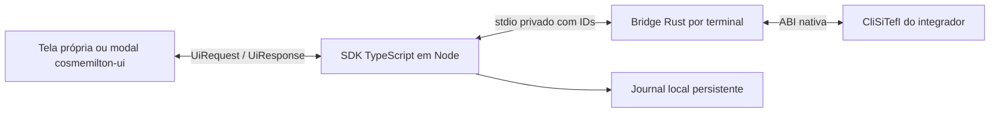

# Decisões de arquitetura

O objetivo é simplificar integração sem esconder o protocolo financeiro nem as
obrigações fiscais do aplicativo. O núcleo atende Node e não carrega frameworks
visuais. O integrador escolhe callback assíncrono ou nosso adaptador React.

## Rust, Go ou C++

Escolhemos Rust para concentrar a fronteira FFI em um executável pequeno, com
buffers e conversões explícitos. C++ também é viável; Go exigiria uma camada cgo/C
para chamadas por ponteiros e toolchain cruzada. Nenhuma linguagem elimina
falhas dentro da biblioteca externa. Por isso o processo isolado é uma decisão
mais importante que a linguagem da ponte.

Um addon no processo Node deixaria seu processo sujeito a falhas nativas. O runtime
é exclusivamente Windows x64: Node, ponte Rust e bibliotecas do integrador usam
x64. A ponte separada continua útil para conter falhas e serializar o acesso.
O WSL é o ambiente de desenvolvimento; não se afirma suporte nativo Linux a partir
de uma DLL Windows. O kit x86 é usado somente como fonte dos PDFs mais recentes;
não há suporte de execução x86 e os PDFs do kit x64 não são referência do projeto.

## Limites e responsabilidades

- Uma sessão serializa o terminal. O journal usa exclusividade por arquivo; o
  integrador mantém um caminho canônico por loja/terminal em todas as instâncias.
- A ponte aceita somente métodos e assinaturas conhecidos, sem FFI arbitrária.
  `capabilities` informa símbolos existentes; existência não prova correção funcional.
  A versão x64 é mais antiga que o kit documental: funcionalidades recentes não
  são presumidas disponíveis. Ausências são explícitas e parâmetros não são
  descartados para contornar versões antigas.
- Nenhum parâmetro adicional é descartado por falta de cadastro. Retornos são
  classificados por contexto, mantendo o número original e descrições desconhecidas.
- O loop mantém os ponteiros de comando/tipo/tamanhos nativos e ecoa os dados do
  comando0 exatamente. Dados de coleta não são reutilizados de uma iteração anterior.
- Cancelamento usa o protocolo e espera o retorno terminal. Timeout/crash requer
  reconciliação; não há replay, confirmação ou desfazimento automático.
- A decisão fiscal é explícita. O journal registra identidade e escopo antes da
  decisão. A rotina `void` de finalização não fornece confirmação remota.
- A aplicação imprime comprovantes quando exigido, persiste seu fechamento fiscal
  e consulta pendências para sua política de recuperação. Esses serviços pertencem
  ao PDV; não podem ser simulados como sucesso pelo SDK.
- No navegador/Electron, apenas DTOs mínimos atravessam o canal autenticado ou
  preload restrito. O renderer não ganha acesso a DLL, paths ou métodos genéricos.
- O modal usa componentes e tokens de cosmemilton-ui, com mensagens operacionais
  no fluxo de transação e notificações por CmToastNotice. Não exige interface no core.

## Verificação e próximos limites

Os testes próprios cobrem motor, IPC, persistência, cancelamento, contextos de
retorno, UI e uma ABI C original. O smoke do kit real cobre carregamento, inventário
de símbolos, versão e configuração; não executa pagamento nem homologa produto.

A matriz `protocol-coverage.md` lista rotinas implementadas, alternativas ASCII,
interfaces obsoletas e assinaturas que ainda dependem dos headers. O kit Linux,
documentos de produtos, lista adicional de parâmetros e tabela de mensagens são
necessários para concluir a cobertura e executar uma homologação abrangente.

O cliente de alto nível mantém uma operação aguardando decisão por vez. Ele ainda
não coordena um lote de vários pagamentos TEF pendentes no mesmo cupom. Esse fluxo
exige um journal de lote e política fiscal própria; não confirmar cada pagamento
prematuramente para contornar o bloqueio. A ponte de baixo nível expõe o protocolo,
mas sua utilização direta transfere à aplicação toda essa coordenação. O lote é
uma evolução explícita antes de habilitar esse cenário no cliente simplificado.

Referências de ABI: [Windows x64 calling convention](https://learn.microsoft.com/en-us/cpp/build/x64-calling-convention?view=msvc-170)
e [modelo LLP64](https://learn.microsoft.com/en-us/windows/win32/winprog64/abstract-data-models).
Os ponteiros são de 64 bits; `int` e `long` continuam com 32 bits no Windows x64.
