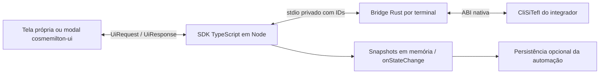

# Decisões de arquitetura

O objetivo é simplificar integração sem esconder o protocolo financeiro nem as
obrigações fiscais do aplicativo. O núcleo atende Node e não carrega frameworks
visuais. O integrador escolhe callback assíncrono ou nosso adaptador React.

## Uma conexão, várias transações

`ClientSitef.create(config)` pertence à inicialização da aplicação/cliente, não
a cada pagamento. Cria a ponte, carrega a biblioteca e chama a configuração uma
vez. O mesmo cliente cria objetos `Transaction` com `createTransaction(input)`;
`process(callbacks)` executa cada ciclo em sequência. `confirm()` e `undo()`
selecionam o ID daquela transação. `dispose()` libera o objeto sem decidir nem
fechar a conexão. `client.close()` pertence ao encerramento da aplicação.

O manual comum VRS-260 do kit x86, §5.1, pp.11–12, determina a chamada de
`ConfiguraIntSiTefInterativoEx` antes das demais e permite reutilizar a
configuração enquanto ela não mudar. Por isso não há configuração repetida no
início de cada `Transaction`. A fachada não é um singleton de todo o processo:
duas chamadas de `create` criam duas conexões. Não as use simultaneamente para o
mesmo terminal. O manual também alerta que uma conexão com a mesma loja/terminal
pode derrubar a anterior e provocar o tratamento `CancPDV`. Uma transação antiga
aguardando decisão é diferente de uma conexão concorrente ainda ativa.

`ClientSitef` oferece o ciclo por objetos e callbacks. `SitefClient` permanece
como API avançada, acessível por `client.advanced`, com consultas, seletores
fiscais e recuperação explícita. Nenhuma camada confirma em `finally`, repete
uma operação incerta ou resolve pendências ao fechar. Configuração, persistência,
impressão, assinatura e decisões comerciais continuam com o integrador.
Veja [cliente e transações](client-transactions.md).

## Rust, Go ou C++

Escolhemos Rust para concentrar a fronteira FFI em um executável pequeno, com
buffers e conversões explícitos. C++ também é viável; Go exigiria uma camada cgo/C
para chamadas por ponteiros e toolchain cruzada. Nenhuma linguagem elimina
falhas dentro da biblioteca externa. Por isso o processo isolado é uma decisão
mais importante que a linguagem da ponte.

Um addon no processo Node deixaria seu processo sujeito a falhas nativas.
No Windows x64, Node, ponte e interface do integrador usam x64. No Linux glibc,
Node/Electron x64 ou ia32 inicia uma ponte **i686** que carrega a biblioteca
Linux32 em seu próprio processo. A arquitetura da ponte segue a biblioteca,
não necessariamente Node. A ponte separada também contém falhas e serializa
o acesso. Não há execução de DLL Windows no Linux.

O core resolve um pacote opcional por plataforma ou respeita um caminho manual
explícito. Os dois pacotes contêm apenas a ponte própria; o kit do fornecedor
permanece separado. Veja [distribuição e configuração](bridge-distribution.md).

A referência documental continua baseada nos PDFs do kit Windows x86; PDFs
do kit Windows x64 não são fonte do projeto. O alvo Linux i686 usa ABI C,
ponteiros de 32 bits e long de 32 bits. Uma ponte Linux x64 com long de 64 bits
não é substituta. Não há suporte a Windows x86, Linux ARM/musl ou biblioteca
Linux64 nesta distribuição.

## Limites e responsabilidades

- Uma instância serializa suas chamadas nativas. A automação coordena processos,
  PDVs e pinpad; não existe mutex global. O adaptador opcional de journal oferece
  exclusividade somente por arquivo, não entre caminhos ou equipamentos.
- A ponte aceita somente métodos e assinaturas conhecidos, sem FFI arbitrária.
  `capabilities` informa símbolos existentes; existência não prova correção funcional.
  A versão x64 é mais antiga que o kit documental: funcionalidades recentes não
  são presumidas disponíveis. Ausências são explícitas e parâmetros não são
  descartados para contornar versões antigas.
- Nenhum parâmetro adicional é descartado por falta de cadastro. Retornos são
  classificados por contexto, mantendo o número original e descrições desconhecidas.
- O loop mantém os ponteiros de comando/tipo/tamanhos nativos e ecoa os dados do
  comando0 exatamente. Dados de coleta não são reutilizados de uma iteração anterior.
- Cancelamento usa o protocolo e espera o retorno terminal. Timeout/crash requer
  reconciliação; não há replay, confirmação ou desfazimento automático.
- A decisão fiscal é explícita. O estado registra identidade e escopo antes da
  decisão; `onStateChange` ou o journal opcional são aguardados quando fornecidos.
  A rotina `void` de finalização não fornece confirmação remota.
- A aplicação imprime comprovantes quando exigido, persiste seu fechamento fiscal
  e consulta pendências para sua política de recuperação. Esses serviços pertencem
  ao PDV; não podem ser simulados como sucesso pelo SDK.
- No navegador/Electron, apenas DTOs mínimos atravessam o canal autenticado ou
  preload restrito. O renderer não ganha acesso a DLL, paths ou métodos genéricos.
- O modal usa componentes e tokens de cosmemilton-ui, com mensagens operacionais
  no fluxo de transação e notificações por CmToastNotice. Não exige interface no core.

## Verificação e próximos limites

Os testes próprios cobrem motor, IPC, persistência, cancelamento, contextos de
retorno, UI e uma ABI C original. O smoke do kit real cobre carregamento, inventário
de símbolos, versão e configuração; não executa pagamento nem homologa produto.

A matriz `protocol-coverage.md` lista rotinas implementadas, alternativas ASCII,
interfaces obsoletas e assinaturas que ainda dependem dos headers. O kit Linux32
fornecido já permite validação limitada de carga/configuração/versão. Headers
oficiais das versões, documentos de produtos, lista adicional de parâmetros e
tabela de mensagens continuam necessários para concluir a cobertura e executar
uma homologação abrangente.

O estado V2 conserva vários pagamentos, inclusive de cupons/datas diferentes.
Pendência anterior não impede outro ciclo; operação nativa ativa e conexão
dessincronizada continuam impedindo chamadas inseguras. Finalização por transação
exige alcance inequívoco; finalização fiscal escolhe explicitamente todos os
pagamentos do cupom/data. Não confirme prematuramente para liberar uma nova venda.

Referências de ABI: [Windows x64 calling convention](https://learn.microsoft.com/en-us/cpp/build/x64-calling-convention?view=msvc-170)
e [modelo LLP64](https://learn.microsoft.com/en-us/windows/win32/winprog64/abstract-data-models).
Os ponteiros são de 64 bits; `int` e `long` continuam com 32 bits no Windows x64.
